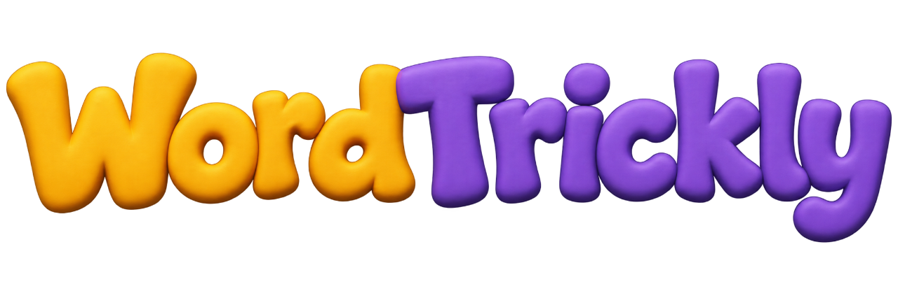
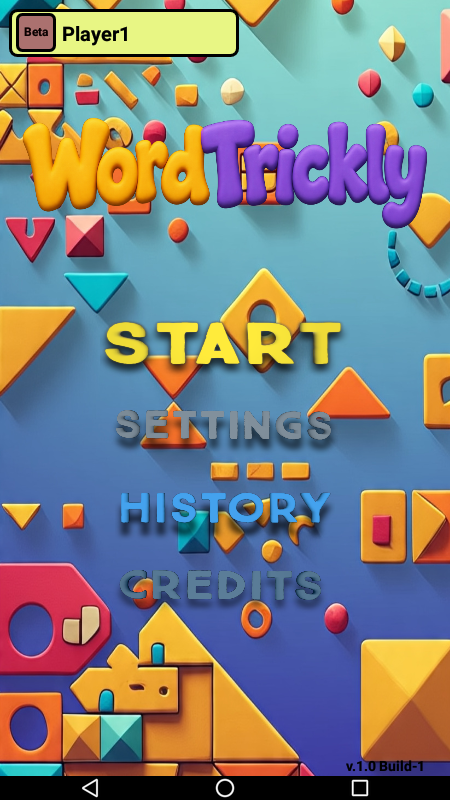
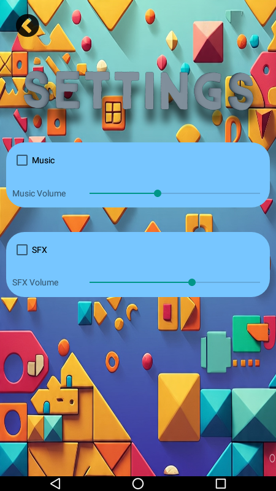
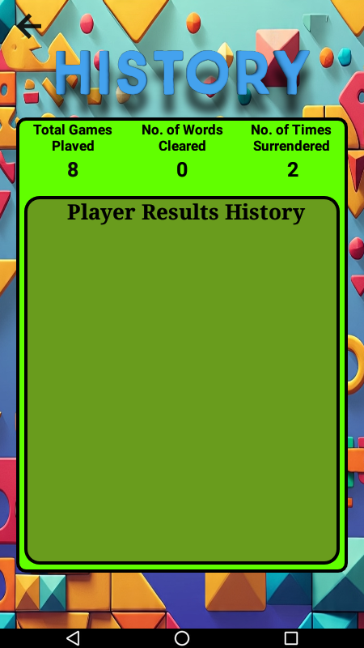
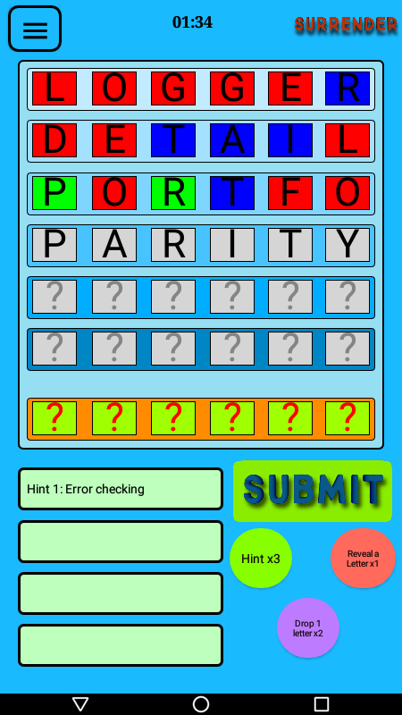
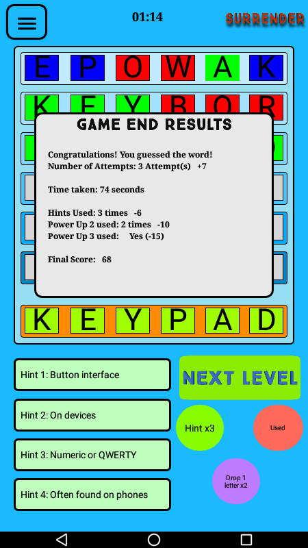

  

<h1 align="center">WordTrickly</h1>

  <b>Think. Guess. Outsmart.</b>

  A clever word puzzle game powered by hints, letter discovery, and strategy.

  
  
  

---

## 📖 About the Project

**WordTrickly** is an interactive word-guessing puzzle game that challenges players to put their vocabulary, logical thinking, and problem-solving skills to the test.

Players must uncover a hidden word within a limited number of attempts while strategically utilizing special power-ups to help them solve each challenge.

By combining contextual hints, letter-discovery mechanics, and limited-use abilities, WordTrickly offers an engaging puzzle-solving experience that rewards both knowledge and strategy.

### 🎮 Gameplay Rules

- Players have a maximum of **6 attempts** to guess the hidden word correctly.
- Each attempt challenges players to use their vocabulary and deduction skills to narrow down the possible answers.
- Players can strategically use available power-ups to gain additional clues and improve their chances of solving the puzzle.
- **Surrender Option** – Allows players to end a challenging round
  and reveal the hidden word.

### ⚡ Power-Ups

WordTrickly features **three unique power-ups**, each providing a different type of assistance to help players solve challenging words.

- **Hint** – Provides contextual clues related to the hidden word. Each round starts with one general hint, while additional hints reveal more specific information. Can be used up to **3 times per round**.

- **Drop Letter** – Reveals one letter from the hidden word but places it in an incorrect position, helping players narrow down possible word combinations. Can be used up to **2 times per round**.

- **Reveal Letter** – Reveals one letter from the hidden word and places it in its correct position, providing a more direct clue. Can be used **once per round**.

## ✨ Additional Features

- **Game History** – Keeps a record of completed games, allowing players to review and compare their previous game results.

- **Background Music & Sound Effects (BGM/SFX)** – Features background music and sound effects to create a more immersive and engaging gaming experience.

- **Local Game Data Storage** – Automatically saves player game data locally, preserving game history even after closing the application.

## 📸 Screenshots

### 🏠 Main Menu

  

### ⚙️ Audio Settings

  

### 📜 Game History

  

### 🎮 Gameplay

<table align="center">
  <tr>
    <td align="center">
      <b>Gameplay</b>  
      
    </td>
    <td align="center">
      <b>End-of-Game Results</b>  
      
    </td>
  </tr>
</table>

## 📥 Download

Download the latest release of WordTrickly below.

**[⬇️ Download WordTrickly v1.0](https://drive.google.com/file/d/1fu0xmEOOQWOASc2Eg67R04UI9WmsBZm7/view?usp=drive_link)**

## 📌 Ownership & Credits Clarification

This game was originally developed as a commissioned school project. As agreed upon by the clients, the creator retains full ownership of the entire source code and its associated intellectual property.

The names displayed on the in-game credits page are included solely for acknowledgment and verification purposes as part of the school's project requirements. Their appearance in the credits does not imply ownership or authorship of the source code.

---

  <a href="#top">⬆ Back to Top</a>

